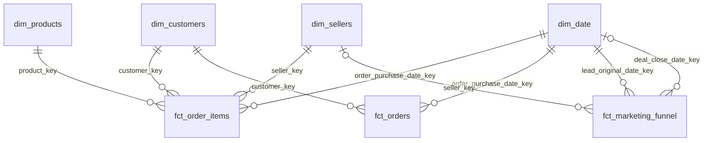
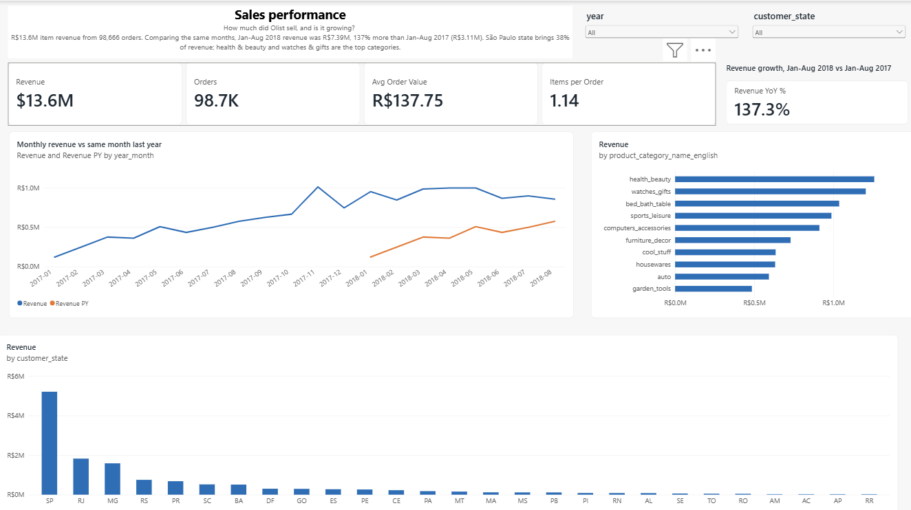
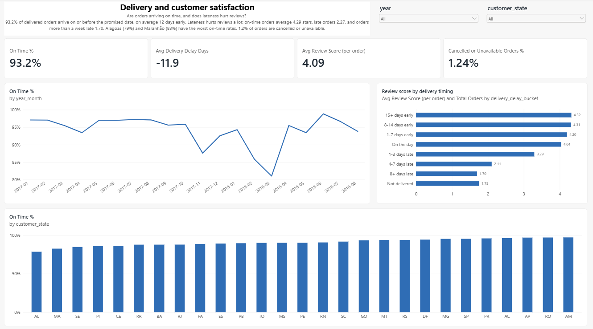
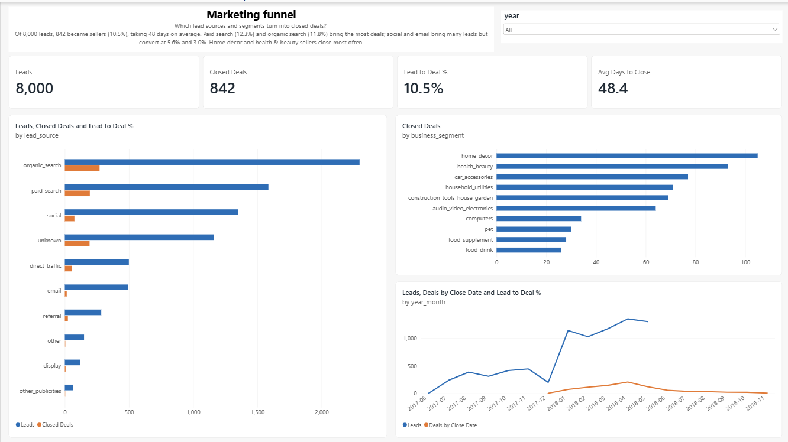
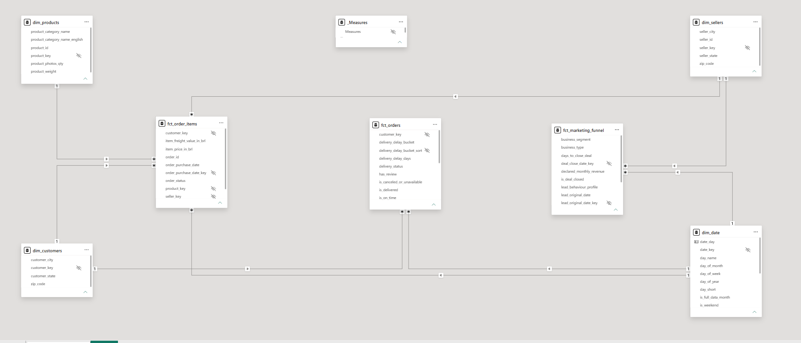

# dbt-Olist

End-to-end dbt pipeline built on Databricks using the Brazilian [Olist e-commerce dataset](https://www.kaggle.com/datasets/olistbr/brazilian-ecommerce). Covers raw ingestion through the mart layer across two business domains — sales and marketing — with incremental models, SCD Type 2 snapshots, singular tests, and a scheduled GitHub Actions build running against Databricks.

---

## Architecture


```
Seeds (CSV)
    ├── Sales domain
    │    └── Staging (stg_sales__*)
    │         ├── Dimensions: dim_customers, dim_products, dim_sellers, dim_date
    │         ├── fct_orders          (table; one row per order, from staging)
    │         └── Intermediate
    │              └── int_orders_enriched   ← order items + orders + payments + reviews joined
    │                   └── Marts
    │                        └── fct_order_items     (incremental, Delta)
    │
    └── Marketing domain
         └── Staging (stg_marketing__*)
              └── Marts
                   └── fct_marketing_funnel  (incremental, Delta; reuses dim_sellers and dim_date)

Snapshots
    └── snapshot_sellers   (SCD Type 2 — check strategy)
```

No intermediate layer for marketing — only two source tables with a single join on `mql_id`. An intermediate model would add complexity with no reusable logic.

---

## Star Schema

Kimball-style dimensional model: two fact tables sharing conformed dimensions.



| Table | Grain | Primary key |
|---|---|---|
| `fct_order_items` | one row per order line item | `order_item_key` |
| `fct_orders` | one row per order (all orders, including those with no items) | `order_id` |
| `fct_marketing_funnel` | one row per marketing qualified lead | `marketing_funnel_key` |
| `dim_customers` | one row per `customer_unique_id` (latest order location) | `customer_key` |
| `dim_products` | one row per product | `product_key` |
| `dim_sellers` | one row per seller (current location) | `seller_key` |
| `dim_date` | one row per day, 2016-01-01 to 2018-12-31 | `date_key` (yyyyMMdd) |

- **Conformed dimensions:** `dim_sellers` and `dim_date` are shared by the sales and marketing facts, so sales and funnel numbers can be sliced by the same seller and date.
- **Role-playing dimension:** `fct_marketing_funnel` joins `dim_date` twice, once for the lead date and once for the deal close date.
- **Nullable keys on purpose:** `seller_key` and `deal_close_date_key` in the funnel are null for leads that never closed, so drop-off stays visible.
- Every foreign key has a `relationships` test back to its dimension.

---

## What This Demonstrates

- **Incremental models** — `fct_order_items` uses a Jinja macro (`incremental_filter`) for the lookback window; `fct_marketing_funnel` uses an inline CTE watermark on `lead_original_date`
- **SCD Type 2 snapshot** — `snapshot_sellers` tracks changes to `seller_city`, `seller_state`, `seller_zip_code_prefix` using dbt's check strategy (no timestamp column required in source)
- **Dimensional modelling (Kimball)** — 3 facts and 4 dimensions with surrogate keys, conformed dimensions (`dim_sellers`, `dim_date`) and a role-playing date dimension (see Star Schema)
- **Two business domains** — sales and marketing modelled separately with isolated schemas, shared dims (`dim_sellers`, `dim_date`) reused across domains
- **Full funnel modelling** — `fct_marketing_funnel` includes unconverted leads with nulls on deal columns to preserve drop-off visibility
- **Test coverage** — `not_null`, `unique`, `accepted_values`, relationship tests, and 6 singular tests
- **GitHub Actions CI** — `dbt build` runs on schedule against Databricks prod (`olist_prod_*` schemas); seeds only reload when CSVs change via git diff check
- **Schema separation** — dev and prod schemas fully isolated via `generate_schema_name` macro
- **dbt_utils** — `dbt_utils.star()` used in mart models

---

## Tech Stack

| Tool | Purpose |
|---|---|
| dbt-databricks | Transformation layer |
| Databricks | Compute + Delta Lake storage |
| Delta Lake | Incremental materializations |
| GitHub Actions | Scheduled build — automated dbt build on schedule |
| Python / venv | Local development |

---

## Schema Structure

| Schema | Contents |
|---|---|
| `olist_dev_raw` | Sales seeds (orders, customers, products, sellers, payments, reviews, order items) |
| `olist_dev_mkt_raw` | Marketing seeds (MQL, closed deals) |
| `olist_dev_stg` | Sales staging models |
| `olist_dev_mkt_stg` | Marketing staging models |
| `olist_dev_marts` | Sales intermediate + marts |
| `olist_dev_mkt_marts` | Marketing marts |

Prod schemas follow the same pattern with `olist_prod_*` prefix.

---

## Key Models

### fct_order_items
- **Grain:** one row per order line item
- **Incremental strategy:** merge on `order_item_key`, filtered via `incremental_filter` macro using max watermark on `order_purchase_date`
- **Foreign keys:** `product_key`, `seller_key`, `customer_key`, `order_purchase_date_key`
- **Item-level measures:** `item_price_in_brl`, `item_freight_value_in_brl`, `total_item_value_in_brl`
- **Order-level columns repeated on every item row:** `total_payment_value_in_brl`, `max_payment_installments`, `payment_method_count`, `paid_by_*`, `avg_review_score`. Never sum these across items. Revenue = price + freight; orders = distinct `order_id`.

### fct_orders
- **Grain:** one row per order (`order_id`), all 99,441 orders, including the 775 orders with no items (mostly canceled or unavailable) that `fct_order_items` cannot see
- **Materialization:** table (rebuilt each run)
- **Foreign keys:** `customer_key`, `order_purchase_date_key`. No product or seller key: an order can hold several of each
- **Use it for:** order counts by status, cancellation rate, delivery (`is_delivered`, `is_on_time`, `delivery_delay_days`, `delivery_status`, `delivery_delay_bucket`) and `review_score`. Order-level values here are safe to sum and average
- **Tested:** row count equals `stg_sales__orders`, `order_id` unique, keys not null and related

### fct_marketing_funnel
- **Grain:** one row per marketing qualified lead (MQL)
- **Incremental strategy:** inline CTE watermark. Each run picks up new leads and older leads whose deal closed since the last run, so a late conversion updates the existing row
- **Includes unconverted leads** — leads with no closed deal have `is_deal_closed = false`, nulls on `seller_key`, `deal_close_date_key`, `days_to_close_deal` and `declared_monthly_revenue`, and `'not closed'` in `business_segment`, `lead_type`, `lead_behaviour_profile` and `business_type`. A null `lead_source` becomes `'unknown'`
- **Foreign keys:** `seller_key` (nullable), `lead_original_date_key`, `deal_close_date_key` (nullable)
- **Key columns:** `marketing_funnel_key`, `mql_id`, `lead_original_date`, `lead_source`, `is_deal_closed`, `days_to_close_deal`, `business_segment`, `lead_type`, `lead_behaviour_profile`, `business_type`, `declared_monthly_revenue`, `sales_rep_id`, `sales_manager_id`
- **Note:** `sales_rep_id` and `sales_manager_id` are deal attributes, not foreign keys — no relationship test, `not_null` only

### Dimensions
- `dim_products` — left join to the category translation table, so every product is kept. Products with no category show as `unknown`; categories with no English translation fall back to the Portuguese name. Use `product_category_name_english` for reporting.
- `dim_customers` — one row per `customer_unique_id`, with city and state from the customer record of their most recent order.
- `dim_sellers` — one row per seller, city and state from the seller record, current location only. It is built from staging, not from `snapshot_sellers`.
- `dim_date` — date spine, one row per day, `date_key` is yyyyMMdd. `day_of_week` follows Spark SQL (1 = Sunday). `month_start` is the first day of the month. `is_full_data_month` is true from Jan 2017 to Aug 2018 (vars `full_data_start` / `full_data_end`), the months where order data is complete.

### snapshot_sellers
- **Strategy:** check — fires when `seller_city`, `seller_state`, or `seller_zip_code_prefix` changes
- **Why check over timestamp:** source data has no reliable updated_at column on sellers
- **dbt columns added:** `dbt_scd_id`, `dbt_valid_from`, `dbt_valid_to`, `dbt_updated_at`

### int_orders_enriched
- Starts from `stg_sales__order_items`, inner joins `stg_sales__orders`, and left joins payments and reviews, each aggregated to one row per order first
- Feeds `fct_order_items` — centralises order-level enrichment so mart logic stays clean
- Because payments and reviews are order-level, their columns repeat on every item row (see `fct_order_items`)

---

## How to Run

**Prerequisites:** Python 3.12, a venv (`python -m venv dbt-env`), `pip install dbt-core dbt-databricks`, Databricks workspace access, and a `profiles.yml` in the project root (gitignored). Keep the token out of the file: use `token: "{{ env_var('DATABRICKS_TOKEN') }}"` and set `$env:DATABRICKS_TOKEN` in your shell.

```bash
# From the project folder, activate the venv
.\dbt-env\Scripts\Activate.ps1

# Install packages
dbt deps --profiles-dir .

# Run full build (dev)
dbt build --profiles-dir .

# Run full refresh on incremental models
dbt build --profiles-dir . --full-refresh

# Run specific model
dbt run --profiles-dir . --select fct_order_items

# Run marketing domain only
dbt build --profiles-dir . --select +fct_marketing_funnel

# Generate docs
dbt docs generate --profiles-dir .
dbt docs serve --profiles-dir .
```

---

## Key Decisions

- **Geolocation CSV trimmed** — lat/long columns dropped, only zip code, city, and state retained. 2M+ rows with coordinates unused in any mart model — keeping them adds size with no analytical value.
- **Products without a category translation were being dropped.** The first `dim_products` used an inner join to the category translation table, so products with no category or no English translation vanished and 1,625 order items ended up with a null `product_key`. The source has no true orphans (0 `product_id` values in `order_items` are missing from products). Fixed with a left join. `product_key` is now tested not null.
- **Incremental filter had no lookback.** `fct_order_items` only read rows dated after the latest date already loaded, so late rows were lost. Comparing dev with prod showed dev 67 items short (112,583 against 112,650); a full refresh closed the gap. The macro now re-reads the last 3 days and merges on `order_item_key`, and `assert_fct_order_items_row_count` compares the fact row count with the source.
- **Orders with no payment records** — kept in `fct_order_items` through a left join, with `total_payment_value_in_brl` set to 0 by `coalesce`, so the order is not lost from sales numbers.
- **Duplicate reviews** — deduplicated in staging with `ROW_NUMBER()` partitioned by `review_id` and `order_id`, keeping the latest answer. Partitioning by `review_id` alone was a bug: the same review can cover several orders, so 550 orders lost their review.
- **Dates stay in Brazil local time.** Staging used to run `convert_timezone('America/Sao_Paulo', 'UTC', ...)` before taking the date. The source timestamps are already local, so every evening purchase or delivery moved to the next day. That changed monthly revenue and made on-time delivery look worse (92.96% instead of 93.23%). Staging now uses `to_date()`.
- **City and state come from the customer and seller records**, not the geolocation table. The geolocation table is missing some zip codes, which turned 269 customers and 7 sellers into `unknown`.
- **Order-grain fact for order questions.** Cancellation rate on `fct_order_items` was 0.47% because orders with no items (most cancellations) were missing. On `fct_orders` it is 1.24%.
- **`incremental_filter` macro in sales, inline CTE in marketing** — macro used in `fct_order_items` because the watermark logic is reusable across sales models. `fct_marketing_funnel` uses an inline CTE because `lead_original_date` is specific to that model — a macro would be over-engineering for one use case.
- **No dim tables for marketing** — `fct_marketing_funnel` reuses `dim_sellers` and `dim_date` from the sales domain. No new dims created because marketing doesn't own any new entities. `sales_rep_id` and `sales_manager_id` are deal attributes, not foreign keys to a rep dimension.
- **No intermediate layer for marketing** — two source tables, one join on `mql_id`. An intermediate model would add a file and a DAG node with no reusable logic.

---

## Modelling Notes and Known Limits

- **Order-level columns on an item-grain fact.** Payment and review columns repeat on every item row. Summing them overstates totals.
- **Partial months at both ends.** Sep-Dec 2016 and Sep-Oct 2018 hold only a handful of orders. Monthly trend charts filter on `dim_date.is_full_data_month` so they don't show fake spikes and drops, and year-on-year growth compares Jan-Aug 2018 with Jan-Aug 2017.
- **`dim_sellers` is current-state.** `snapshot_sellers` tracks changes, but no mart reads it, and the source has never changed, so there is no history yet.
- **`dim_date` covers 2016-2018 only.** A date outside that range gets no `date_key`.
- **The incremental lookback is 3 days.** A row that arrives more than 3 days behind the latest date is still missed until a full refresh. The row count test will fail if that happens.

---

## Scheduled Build

GitHub Actions runs `dbt build` on a schedule against `olist_prod_*` schemas on Databricks.

- Seeds are loaded manually (`git diff` check on the seeds directory)
- Run it manually with **full_refresh** ticked after any change to staging logic or an incremental model's columns (Actions > dbt build > Run workflow)

---

## Power BI Dashboard

`dashboard/` holds the Power BI report (`olist_sales_marketing.pbix`) and everything used to build it: Power Query code (`power_query.m`), a Tabular Editor model script (`model_setup.csx`), the DAX measures (`measures.dax`), reconciliation SQL with expected results (`reconcile.sql`) and a theme.

Three pages, each answering one question:

- **Sales performance** — how much did Olist sell, and is it growing? R$13.6M item revenue from 98,666 orders; Jan-Aug 2018 revenue was 137% above Jan-Aug 2017.
- **Delivery and satisfaction** — are orders on time, and does lateness hurt reviews? 93.2% of delivered orders arrive on or before the promised date. On-time orders average 4.29 stars, late orders 2.27.
- **Marketing funnel** — which lead sources turn into deals? 842 of 8,000 leads closed (10.5%) in 48 days on average.









Model: star schema with three facts (`fct_order_items`, `fct_orders`, `fct_marketing_funnel`) sharing `dim_date`, `dim_customers`, `dim_products` and `dim_sellers`. All relationships are one-to-many, single direction. Deals by close date use `TREATAS` instead of an inactive relationship, so unconverted leads never add a (Blank) item to date slicers.

---

## Dataset

[Olist Brazilian E-Commerce](https://www.kaggle.com/datasets/olistbr/brazilian-ecommerce) — 100k orders from 2016–2018 across Brazilian marketplaces. Two datasets:

- **Sales:** orders, customers, products, sellers, payments, reviews, order items, geolocation
- **Marketing:** marketing-qualified leads (MQL) and closed deals — tracks the seller acquisition funnel from first contact to conversion
